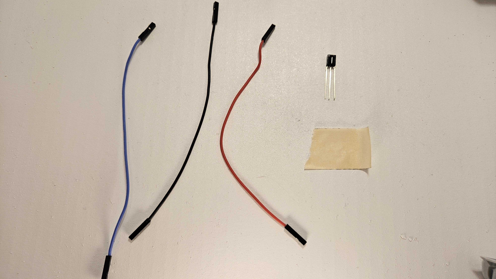
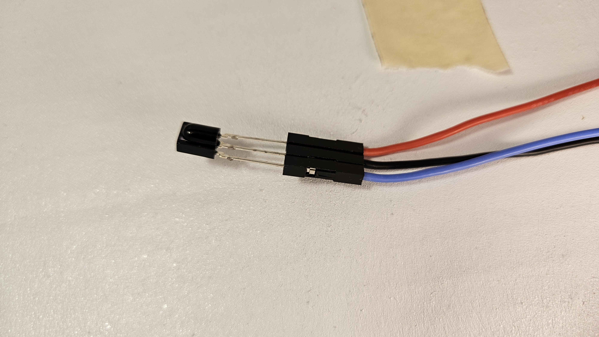
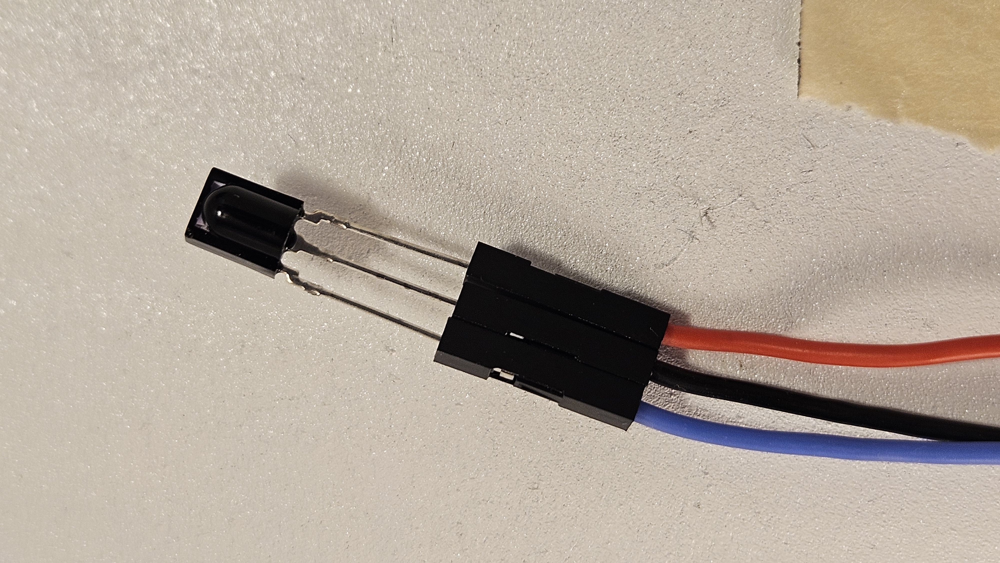
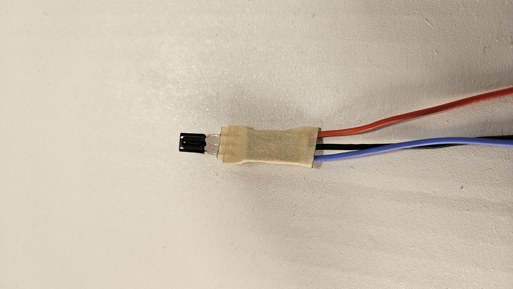
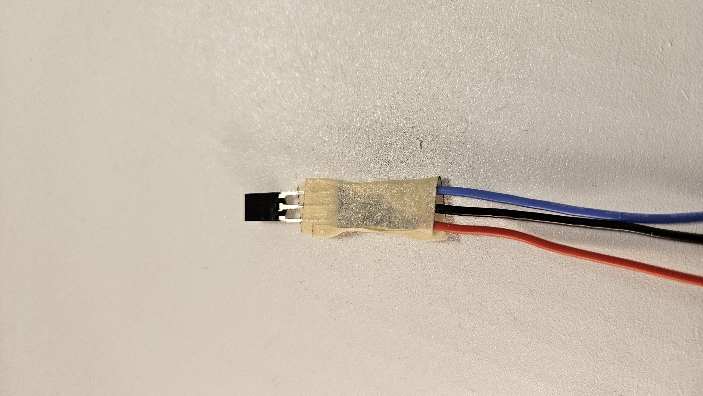

# TSOP38238 IR Receiver Assembly

### Parts
- 15cm Blue Wire
- 15cm Black Wire
- 15cm Red Wire
- TSOP38238 IR Receiver
- Piece of tape

### 1. Identify the receiver pins
The TSOP38238 has three leads. Looking at the receiver from the front with the black IR window facing you, which means the flat part is down and the rounded part is facing up. In this orientation with the pins facing down, the pins are:

- Left pin: `OUT` (signal)
- Middle pin: `GND`
- Right pin: `VCC`

This is the standard TSOP38238 pinout. The receiver is active-low, so the output wire carries the signal back to the Pico.

### 2. Wire the receiver
Connect the three wires to the receiver pins as follows:

- `Blue wire` -> `OUT` (Left Pin)
- `Black wire` -> `GND` (Middle Pin)
- `Red wire` -> `VCC` (Right Pin)

Push the wires carefully yet firmly onto the pins.  Remember to turn the wire ends 90degrees if they are not snug or too snug.  The exact wire colors are not critical, but this color scheme matches the rest of the project and makes debugging easier.

### 3. Tape the wires in place
Use a small piece of tape to secure the receiver and keep the wires from moving around. Try to get the tape around the wire ends and cover most of the metal pins coming from the IR Receiver.  Be sure leave the IR window (the rounded part) clear and visible. 

### Wiring summary
- `Red` = `VCC`
- `Black` = `GND`
- `Blue` = `OUT`

The receiver is now ready to go into the tail.

[back](https://github.com/javaplus/MadScientist/blob/main/lessons/assembly/plate_chassis.md)

[next](https://github.com/javaplus/MadScientist/blob/main/lessons/assembly/tail.md)