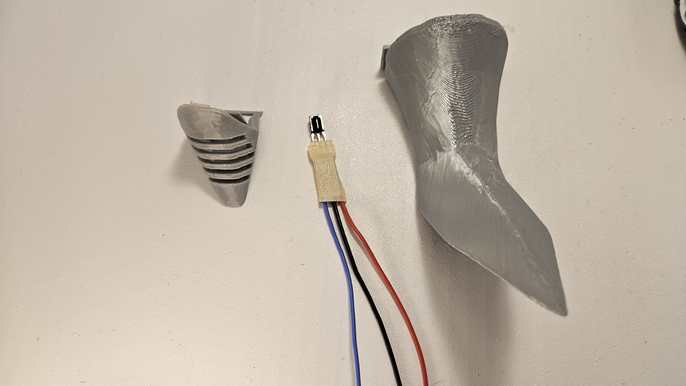
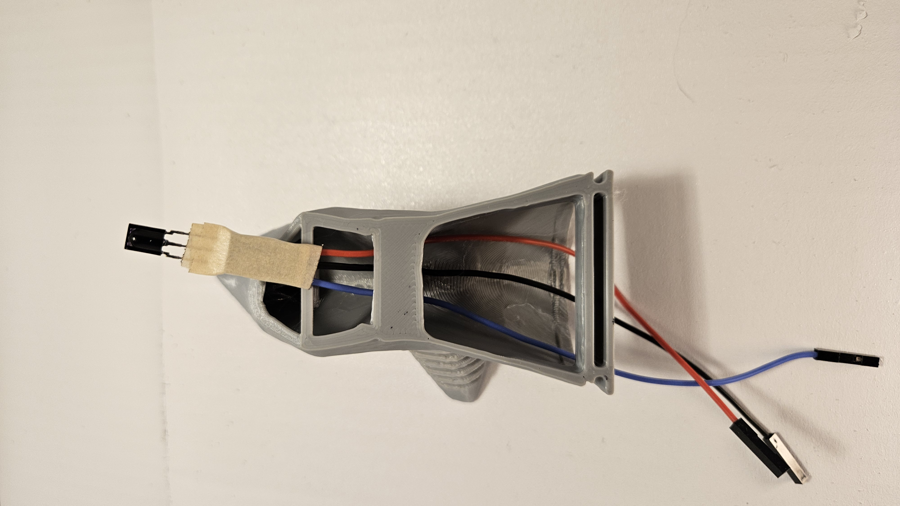
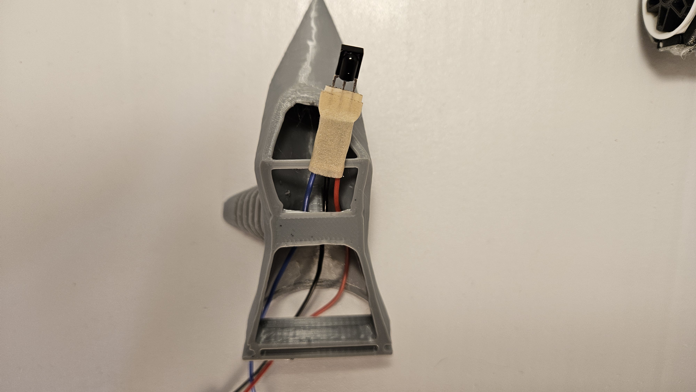
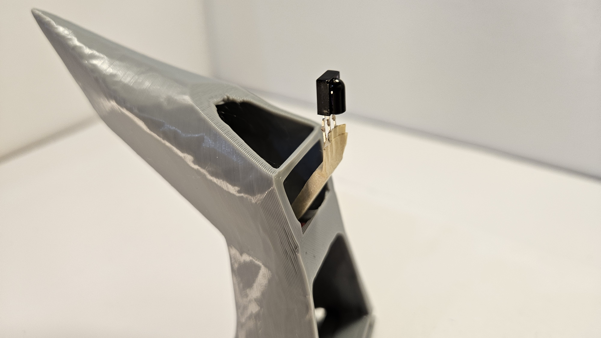
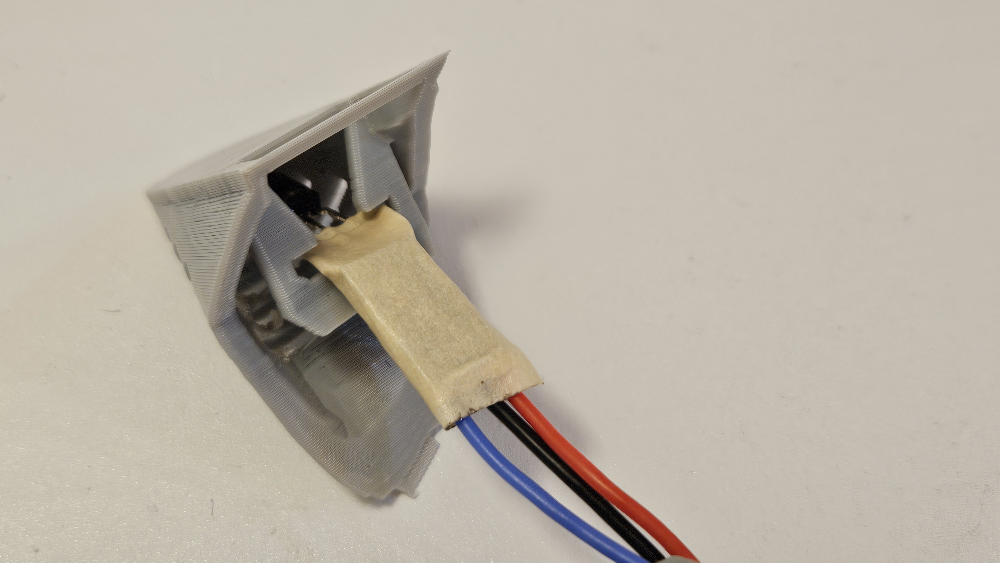
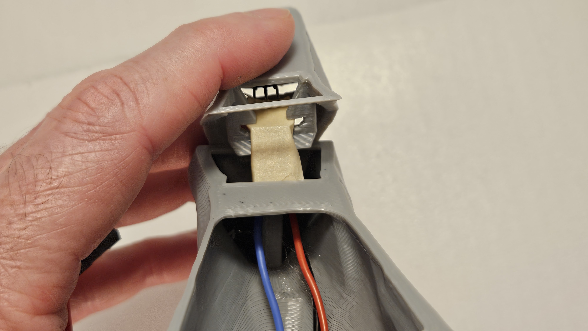
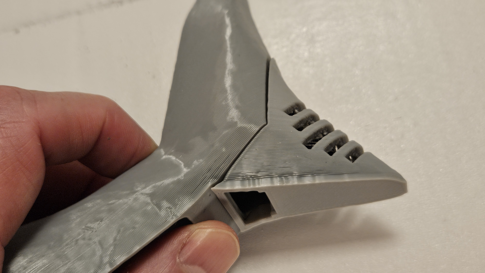
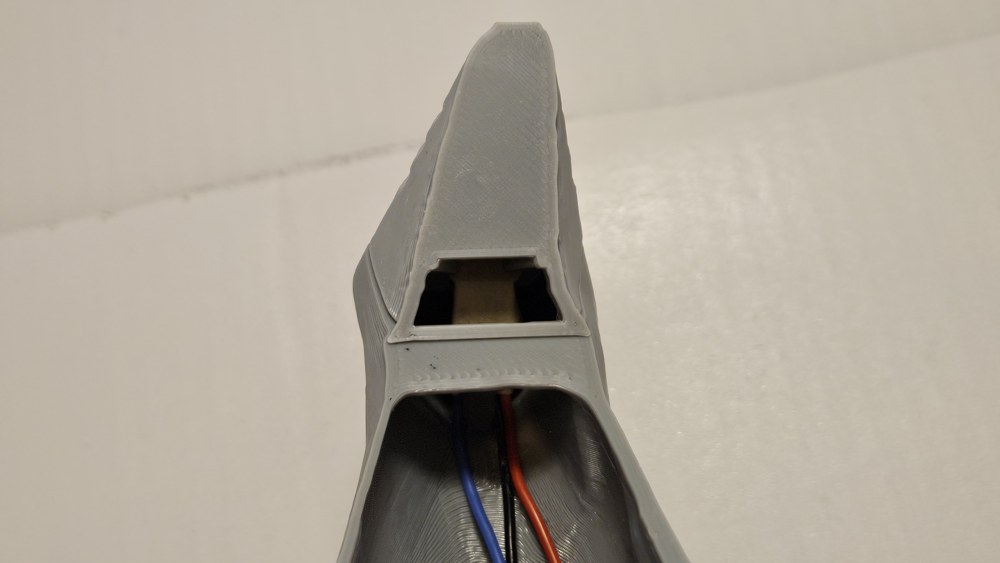

# Tail Assembly with IR Receiver

### Parts

- Tail
- Tail tip
- IR Receiver (Wired)

### Insert IR Receiver

Position the tail upside down (flat side facing up) and grab your wired IR Receiver with the IR window (rounded part facing you), take the ends of the wires and insert them through the middle hole just ontop of the small horizontal bar.  It's best to route the blue wire to the left and the red and black wire to the right around the vertical support inside of the tail.  See images below:

### Bend Wires

Now with the IR Receiver window facing you, firmly hold the wire ends that are connected to the pins of the receiver and carefully bend the receiver back away from you.  You want to put a small bend (about 40 degrees) so that when the pins rest against the horizontal bar the window will face towards the ground (parallel with the flat part of the tail).    
  
 See image below:

### Tail Tip Assembly

Position the tail tip upside down (flat side facing up).
Take your IR Receiver and carefully slide it into the T shaped slot in the tail tip.  The window of the IR Receiver should be facing the flat side of the tail tip when inserted. See the colored wires in the image for proper orientation.  Try to just have the pins of the IR Receiver into the slot and not the wire ends.  The wire ends should not be in the tail tip.

Now bring the tail tip to the tail with the flat sides facing up on both.  Now slide the tab with the T shaped hole of the tail tip into the tail with the tab going into the middle hole just past the horizontal bar on the tail.  This should cause the pins of the receiver to be pinched between the horizontal bar of the tail and the top of the T slot. 

Gently snap the tail tip in place.  It should snap in fairly easily with just a little force. If it's not snapping in, try to slide it side to side just a little while pushing the tail tip into the tail.  Also, ensure that your wire ends are not getting pinched in the T slot, but only the pins are in the slot.

Your tail tip should be snapped in place now with the window of the IR Receiver facing down.  

Why orientation matters
  

If the window is not facing down it will be much easier to be "hit" by other sharks because the receiver will pick up IR signals from a further range and wider angles.  So, if later you want to increase the ability of receiving IR signals you can position the IR Receiver to face directly behind the shark (window vertical, not horizontal). The vertical orientation is not recommended for shark battles as it will make you much easier to hit from a further range and wider angles.

   

[back](https://github.com/javaplus/MadScientist/blob/main/lessons/assembly/plate_chassis.md)

[next](https://github.com/javaplus/MadScientist/blob/main/lessons/assembly/tail_chassis.md)