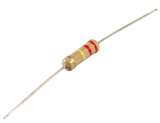

# IR LED

An IR LED is an Infrared Light Emitting Diode.  Just like a regular LED, it only allows electricity to flow in one direction, so there is a positive and negative side — the longer leg is positive (anode) and the shorter leg is negative (cathode).

The difference is that an IR LED emits light in the **infrared spectrum**, which is invisible to the human eye.  Infrared light is used everywhere: TV remotes, motion sensors, wireless communication, and more.

In this lesson we will use the **TSAL6200**, a 5mm 940nm infrared LED, with the Raspberry Pi Pico WH to transmit a simple message in Morse code.

## What to do

We will wire the IR LED to GP16 on the Pico and write a MicroPython program to blink it in the Morse code pattern for **SOS**.  Since we can't see infrared light with our eyes, we'll use a phone camera to verify the LED is actually transmitting.

## How to Know It's Working

Most phone cameras — especially front-facing cameras — are sensitive to infrared light.  Point the phone camera at the IR LED and you should see the LED appear to flash with a purple or white glow in the camera preview even though you can't see anything with your naked eye.

> **Note:** Some newer phones have stronger IR-cut filters and may not show the IR light well.  If your main camera doesn't show it, try the front-facing (selfie) camera.

## Orientation

Orient your Pico the same way as the earlier LED lab — USB connection at the top and the pins pointing up.  This makes it easier to follow the wiring diagram below.

## Resistor — Why You Need One

Unlike the blue LED used in the basic LED lab, the TSAL6200 has a much lower forward voltage (about **1.2V**).  The Pico's GPIO pins output **3.3V**, so connecting the IR LED directly without a resistor would push far too much current through it and could damage both the LED and the Pico pin.

We need to limit the current using a **resistor**.



To calculate the right resistor value:

```
R = (Supply Voltage - LED Forward Voltage) / Desired Current
R = (3.3V - 1.2V) / 0.020A
R = 2.1V / 0.020A
R ≈ 105Ω
```

A **100Ω resistor** would run the LED at ~20mA, giving it a longer range.  For this lesson we will use a **220Ω resistor** instead, which drops the current to ~9.5mA.  The LED is still well within its safe operating range, but the lower current means less radiant intensity — and a shorter effective range.  That is perfect for close-quarters challenges like shark battles where you don't want a signal reaching across the room!

## Wiring Diagram

Connect the components as follows:

1. A wire from **GP16** on the Pico to one end of a **220Ω resistor**.
2. A wire from the other end of the resistor to the **long leg (anode / +)** of the IR LED.
3. A wire from the **short leg (cathode / -)** of the IR LED to a **GND** pin on the Pico.


> **Tip:** If the LED does not appear to transmit, try flipping it — you may have the legs reversed.

## The Code

The program below sends the Morse code distress signal **SOS** ( `· · · — — — · · ·` ) on repeat.  Each dot or dash flashes the IR LED; a phone camera pointed at the LED should show the flashing pattern.

```python
from machine import Pin
import utime

ir_led = Pin(16, Pin.OUT)

DOT_MS       = 200   # length of a dot
DASH_MS      = 600   # length of a dash (3× dot)
SYMBOL_GAP   = 200   # pause between symbols within a letter
LETTER_GAP   = 600   # pause between letters
MESSAGE_GAP  = 2000  # pause before repeating

def dot():
    ir_led.value(1)
    utime.sleep_ms(DOT_MS)
    ir_led.value(0)
    utime.sleep_ms(SYMBOL_GAP)

def dash():
    ir_led.value(1)
    utime.sleep_ms(DASH_MS)
    ir_led.value(0)
    utime.sleep_ms(SYMBOL_GAP)

def send_sos():
    # S = · · ·
    dot(); dot(); dot()
    utime.sleep_ms(LETTER_GAP)
    # O = — — —
    dash(); dash(); dash()
    utime.sleep_ms(LETTER_GAP)
    # S = · · ·
    dot(); dot(); dot()
    utime.sleep_ms(MESSAGE_GAP)

while True:
    send_sos()
```

Enter the code above into Thonny and click the **Play** button to run it.

## Testing with Your Phone

1. Open your phone's camera app.
2. Point it directly at the IR LED (get within a few inches for the best result).
3. You should see the LED flashing with a **purple or white glow** in the camera preview, even though the room looks normal to your eyes.

The flashing pattern you see on the camera is the SOS message being transmitted: three short flashes, three long flashes, three short flashes — then a pause before it repeats.

If you can see the pattern on your phone camera — you've successfully sent a message with infrared light! 🎉

## Understanding the Morse Code Pattern

| Letter | Pattern | Flashes |
|--------|---------|---------|
| S | `· · ·` | 3 short |
| O | `— — —` | 3 long  |
| S | `· · ·` | 3 short |

## Stretch Goal

Can you modify the program to send your initials in Morse code instead of SOS?  A full Morse code reference can be found at [morsecode.world](https://morsecode.world/international/morse.html).
